# NEON TD

Ein Tower-Defense-Spiel im Neon-Look: tiefschwarzer Hintergrund, leuchtende Bahnen und Türme, dazu eine ruhige,
cleane Oberfläche. Die gesamte Spiellogik ist in **Java** geschrieben und läuft

- **auf dem iPhone** (als App auf dem Home-Bildschirm, auch offline – Hochformat ist die Hauptausrichtung),
- **im Browser am PC** und
- als **Desktop-Anwendung** (Windows, macOS, Linux).

<p align="center">
   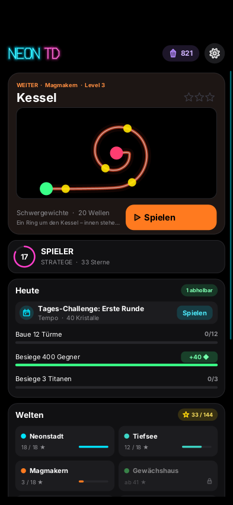 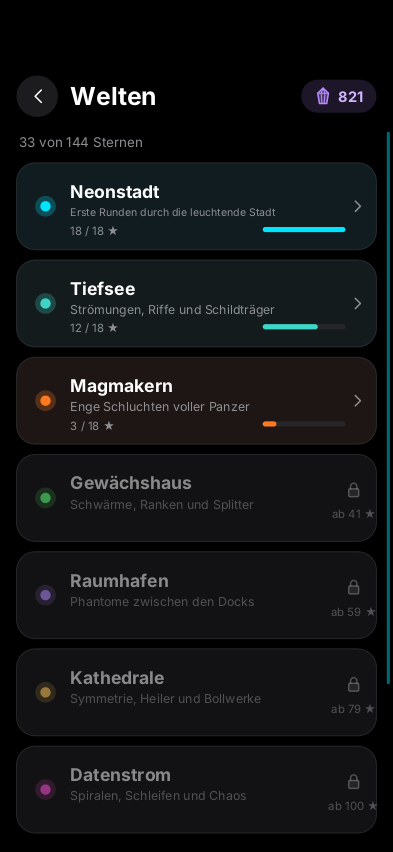 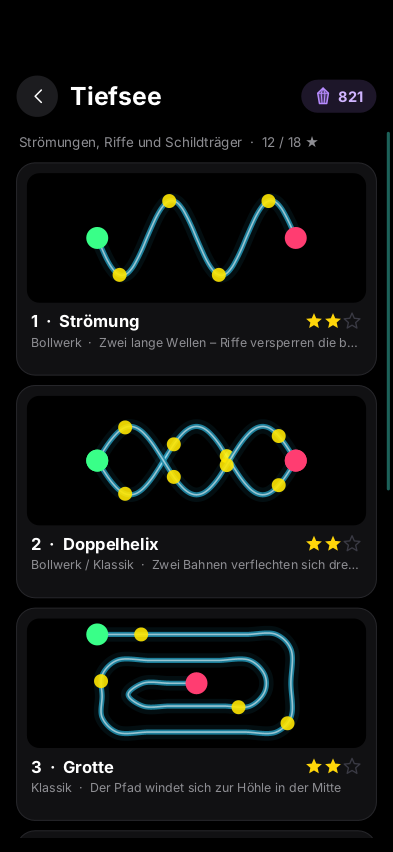 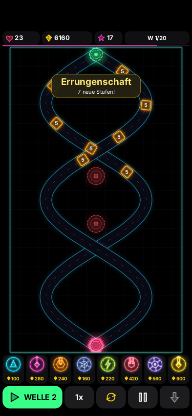
</p>

## Was drin ist

- **Arena – der Wochen-Wettkampf**: Jede Woche eine neue Arena, in der alle mit exakt denselben Regeln antreten
  (gleiche Karte, gleicher Turm-Pool, zwei Joker, 10 Leben, keine Boni aus Shop oder Spielerlevel). Die Wellen werden
  immer härter; gezählt werden **Punkte** mit **Serien-Multiplikator** (bis ×3) und **Vorlauf-Bonus**. Live-Platz,
  Zwischenzeiten gegen den Führenden, globale Rangliste mit Versuchen, Verlauf, Ruhmeshalle und Kristalle fürs Podium –
  siehe [Arena](#arena--der-wochen-wettkampf).
- **Spielername beim ersten Start** (weltweit eindeutig, vom Server geprüft) und ein **Login-Log** in der Datenbank.

- **8 Welten mit 48 handgebauten Strecken**: Neonstadt, Tiefsee, Magmakern, Gewächshaus, Raumhafen, Kathedrale,
  Datenstrom, Ereignishorizont – jede Welt mit eigener Farbe, eigenem Gegner-Rhythmus und eigener Idee (Schleifen,
  Spiralen, Doppelhelix, Loopings, Kreuzungen, drei Bahnen auf eine Basis …). Siehe [Welten und Sterne](#welten-und-sterne).
- **Felder auf der Karte**: **Pads** (Schaden +25 %, Reichweite +25 %, Tempo +20 % für den Turm, der darauf steht) und
  **Sperrzonen** – wer baut, muss sich für die besten Plätze entscheiden.
- **Sterne statt bloßem Sieg**: 3 Sterne ohne verlorenes Leben, 2 mit mindestens der Hälfte, 1 für den Sieg.
  Sterne öffnen Welten (11 · 25 · 41 · 59 · 79 · 100 · 118) und bringen Kristalle und XP – 144 Sterne insgesamt.
- **16 Turmklassen** (8 Grundtürme, 8 Elite-Türme) mit je 3 Upgrade-Kategorien, **16 Ausbaupfade** (zwei
  Spezialisierungen je Grundturm mit je zwei Rängen, die sich ausschließen), ein **Spezial-Platz** je Turm mit 16
  Spezial-Upgrades und dauerhafte **Forschung** – siehe [Die Türme](#die-türme).
- **Tages-Challenge**: Jeden Tag ein anderes Level mit einem Modifikator (Tempo, Sparsam, Glas, Titanen, Schwarm,
  Panzer, Phantome, Zäh) im Endlosmodus – wer Welle 15 erreicht, bekommt 40 Kristalle; eine **Serie** zählt die Tage in Folge.
- **Globale Bestenliste** für die Tages-Challenge, den Endlosmodus und die Sterne (je Gerät der beste Eintrag) –
  siehe [Tages-Challenge, Serie und Bestenliste](#tages-challenge-serie-und-bestenliste).
- **Meta-Spiel über Monate**: Kristalle, Shop (Türme, Spezials, Forschung), Tagesaufgaben, Season-Pass,
  Errungenschaften – bei etwa 10 Minuten am Tag rund **vier Monate** bis alles frei ist.
- **Cleane Oberfläche**: Intro mit aufleuchtendem Schriftzug, dunkle Flächen, ruhige Typografie, Bottom-Sheets und
  Überblendungen zwischen den Seiten. Das Neon bleibt dort, wo es hingehört: auf dem Schlachtfeld.
- **Spielgefühl**: Gegner zerspringen beim Abschuss in Bruchstücke, Treffer stauchen sie, Upgrades plustern den Turm
  auf, das Wellen-Ende feiert an der Basis. Fester Simulationsschritt mit interpolierter Darstellung, allokationsfreie
  Partikel – auf 120-Hz-Displays läuft jedes Bild mit.
- **Wellen wie bei Bloons TD**: Welle manuell (auch früher) starten, Tempo 1×/2×/3× (Endlos 5×), Auto-Start, Pause.
- **Endlosmodus bis Welle 1000** mit Meisterstufen für alle Upgrades – siehe [Endlosmodus](#endlosmodus).
- **Level-Editor** für eigene Strecken, **Speichern und Fortsetzen**, **Cloud-Speicher** über ein privates GitHub-Gist.
- **Physik-Fundament**: Pfade nach Bogenlänge, Broad-Phase, kontinuierliche Kollision, Zielvorhersage, deterministische
  Simulation (siehe [docs/ENTWICKLUNG.md](docs/ENTWICKLUNG.md)).

| Gefecht | Turm gewählt | Ausbaupfade | Sieg mit Sternen |
|:--:|:--:|:--:|:--:|
| 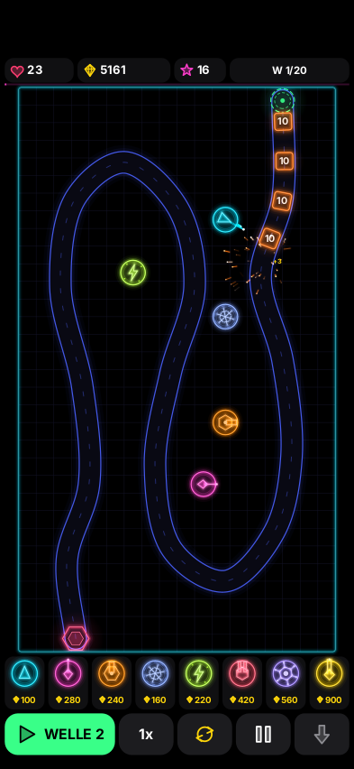 | 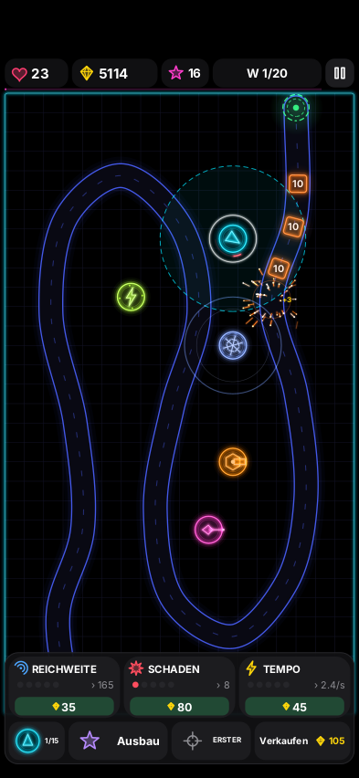 | 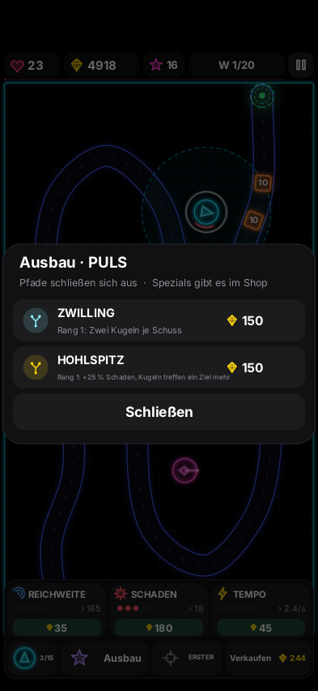 | 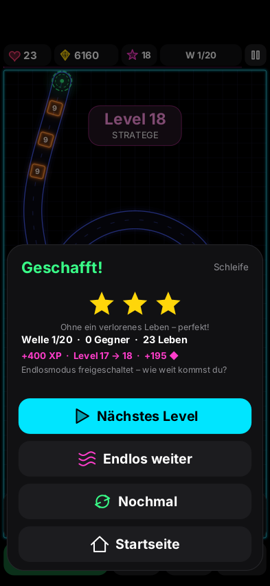 |

| Spielername | Arena | Arena-Lauf | Ergebnis |
|:--:|:--:|:--:|:--:|
| 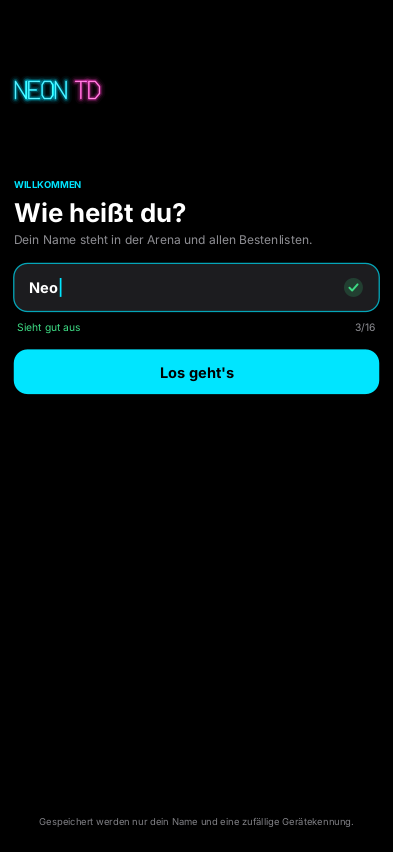 | 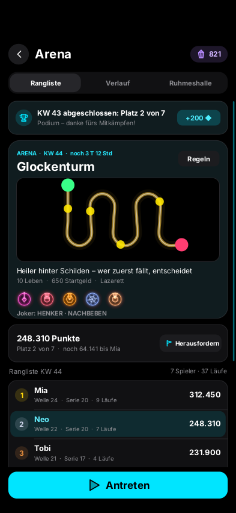 | 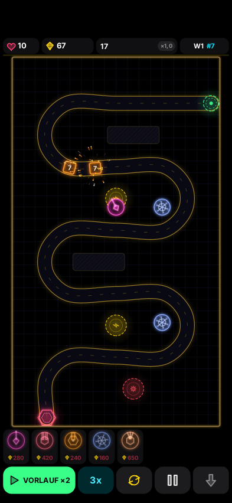 | 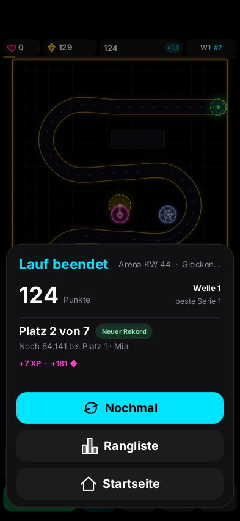 |

| Tages-Challenge | Bestenliste | Profil | Shop |
|:--:|:--:|:--:|:--:|
| 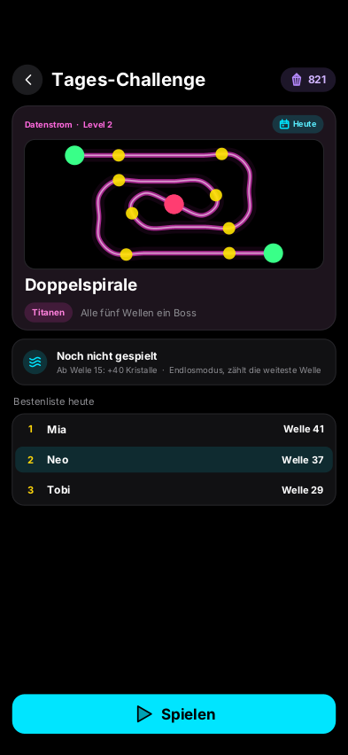 | 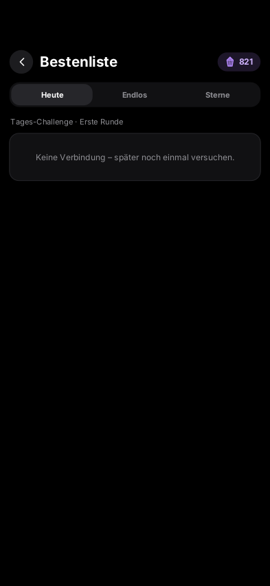 | 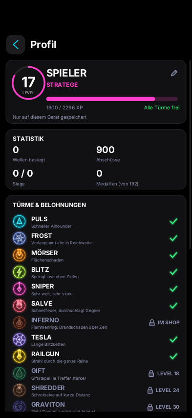 | 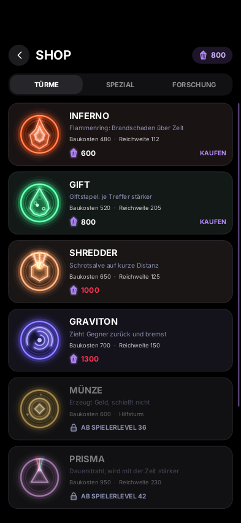 |

| Hauptmenü (PC) | Welten | Level-Editor |
|:--:|:--:|:--:|
| 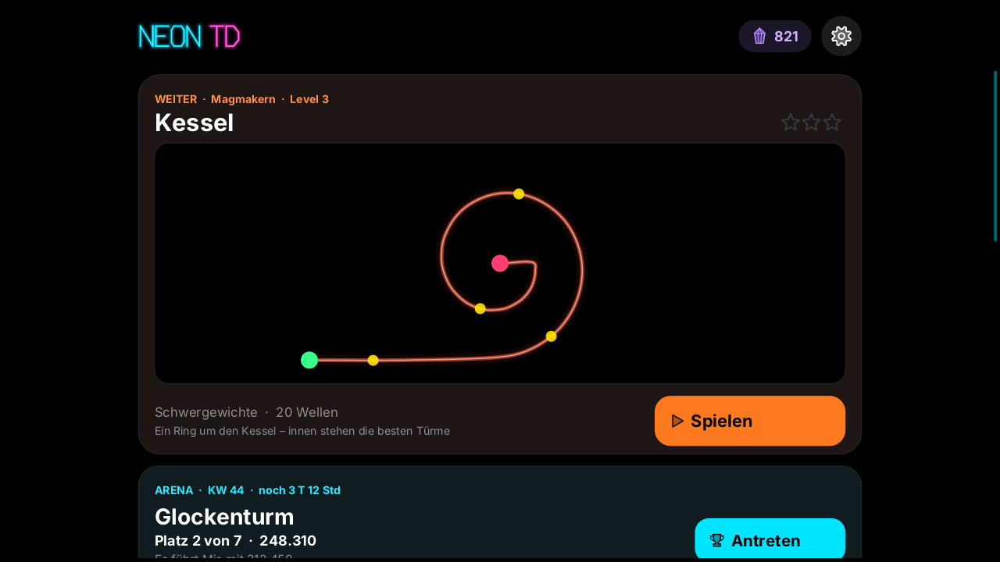 | 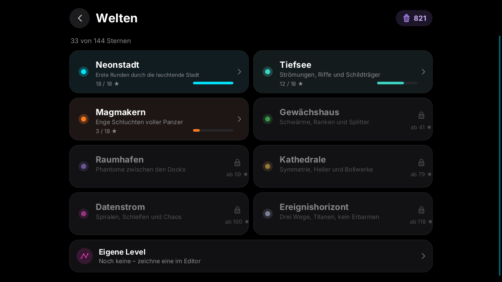 | 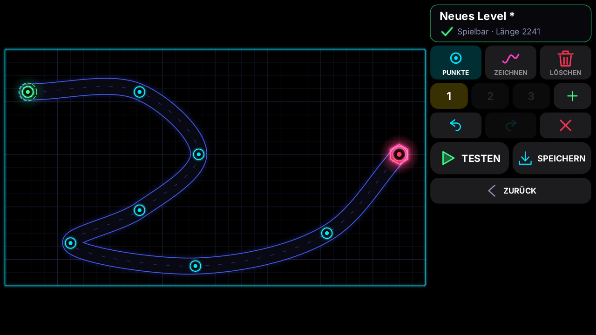 |

<p align="center">
  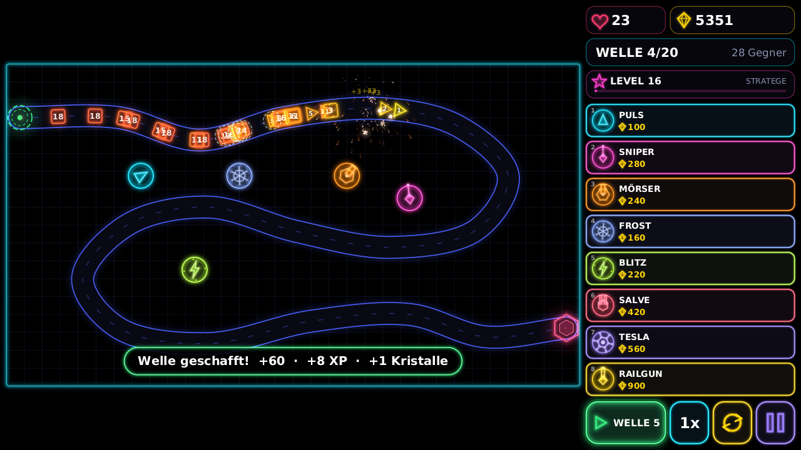<br>
  <sub>Gefecht am PC; der Endlosmodus läuft mit Tempo bis 5× und Meisterstufen für alle Upgrades</sub>
</p>

## Spielen

### Im Browser und auf dem iPhone (empfohlen)

Die Web-Version ist eine statische Seite. Das Repository enthält einen GitHub-Workflow, der sie baut und auf
**GitHub Pages** veröffentlicht:

1. Im Repository **Settings → Pages → Source: „GitHub Actions“** einmalig auswählen
   (bei privaten Repositories hängt die Verfügbarkeit von deinem GitHub-Tarif ab).
2. Der Workflow *Build und Veröffentlichung* läuft bei jedem Push, führt alle Tests aus und veröffentlicht die Seite,
   sobald etwas im **Standard-Branch** des Repositories landet. Solange Pages nicht aktiviert ist, meldet der Lauf nur
   eine Warnung; nach dem Aktivieren unter **Actions** den letzten Lauf öffnen und **Re-run all jobs** wählen.
3. Danach liegt das Spiel unter `https://<dein-name>.github.io/<repository>/` – bei diesem Repository
   `https://t-eilzeitgott.github.io/td-0/`.

Die Artefakte jedes Laufs (Web-Version als Ordner, Desktop-Paket als ZIP) lassen sich außerdem direkt auf der
Actions-Seite herunterladen.

**iPhone:** Adresse in **Safari** öffnen → **Teilen** → **„Zum Home-Bildschirm“**. Danach startet Neon TD im
Vollbild wie eine App und funktioniert nach dem ersten Laden auch **ohne Internet**. Quer- und Hochformat nutzen den
Platz jetzt gut: quer sitzt eine schmale Leiste am rechten Rand, hoch liegt die Karte gedreht (Pfad von oben nach
unten) über einer Leiste am unteren Rand. Der **Pfeil-Knopf** klappt die Leiste ein – dann ist die Karte so groß wie
möglich – und wieder aus; die Wahl wird gemerkt.

> **Gut zu wissen:** Der Safari-Tab und die Home-Bildschirm-App haben auf dem iPhone **getrennte Speicher**. Wer
> beides benutzt, sieht dort zunächst verschiedene Profile. Der [Cloud-Speicher](#speichern-fortsetzen-und-cloud)
> verbindet sie.

Ohne GitHub Pages geht es genauso mit jedem anderen statischen Hosting: den Ordner `web/build/dist` (siehe unten)
hochladen.

### Lokal bauen und im Browser öffnen

Benötigt wird nur ein **JDK 17 oder neuer** – Gradle lädt der mitgelieferte Wrapper selbst.

```bash
./gradlew :web:assembleWeb
python3 -m http.server 8080 -d web/build/dist     # oder ein beliebiger anderer Webserver
```

Dann `http://localhost:8080` öffnen. Zum Testen auf dem iPhone im selben WLAN `http://<IP-des-PCs>:8080` aufrufen
(der Offline-Modus braucht HTTPS bzw. `localhost`, das Spiel läuft aber auch ohne ihn).

Am PC geht es sogar noch einfacher: `web/build/dist/index.html` per **Doppelklick** im Browser öffnen – ganz ohne
Server. Dasselbe gilt für das ZIP *neon-td-web*, das jeder Workflow-Lauf auf der Actions-Seite bereitstellt.

### Desktop-Anwendung

```bash
./gradlew :desktop:run                # direkt starten
./gradlew :desktop:distZip            # Paket bauen: desktop/build/distributions/neon-td-*.zip
```

Das ZIP enthält `bin/neon-td` (bzw. `neon-td.bat` unter Windows); eine Java-Laufzeit ab Version 17 muss installiert sein.
`F11` schaltet Vollbild um. Eigene Level liegen in `~/.neon-td/save.properties`.

## Bedienung

| | Maus / PC | Finger / iPhone |
|---|---|---|
| **Turm bauen** | Karte im Shop anklicken, dann auf die Karte klicken – oder vom Shop auf die Karte **ziehen** | Kachel auf die Karte ziehen: Der Turm schwebt dabei knapp über dem Finger. Nach dem Loslassen bleibt er schweben; **mit einem Finger irgendwo auf der Karte ziehen** schiebt ihn 1:1 weiter (wie ein Trackpad – kein Sprung, der Finger verdeckt ihn nicht). **Haken** baut ihn fest, **Kreuz** verwirft ihn (rot = hier nicht erlaubt) |
| **Turm verbessern** | Turm anklicken → Panel mit *Reichweite / Schaden / Tempo* | Turm antippen |
| **Verkaufen** | Im Panel „Verkaufen“ (zweimal bestätigen), 70 % Erstattung | dito |
| **Zielwahl** | Im Panel: Erster · Letzter · Stärkster · Nächster | dito |
| **Wellen** | `START` / `Leertaste`; `1×/2×/3×` (im Endlosmodus bis `5×`) = `F`; Schleife = Auto-Start; Pause = `P` / `Esc` | Schaltflächen in der Leiste (quer rechts, hoch unten) |
| **Leiste ein-/ausklappen** | – (am Laptop immer sichtbar) | Pfeil-Knopf in der Leiste |

Weitere Tasten: `1`–`8` Turm der aktuellen Shop-Seite wählen · `G` Shop-Seite wechseln · `Q` `W` `E` Upgrade Reichweite/Schaden/Tempo · `R` Spezial-Auswahl · `Tab` Zielwahl · `X`/`Entf`
verkaufen · Rechtsklick bricht ab. Gesperrte Türme (Schloss mit „LV n“) lassen sich erst ab dem genannten Spielerlevel
bauen.

## Die Türme

| Turm | Preis | Reichweite | Schaden | Tempo | Rolle |
|---|---:|---:|---:|---:|---|
| **PULS** (cyan) | 100 | 150 | 4 | 2,0/s | Schneller Allrounder. Kugeln zielen auf die *vorhergesagte* Position |
| **SNIPER** (magenta) | 280 | 330 | 34 | 0,5/s | Sehr weit, sehr stark; der Strahl trifft sofort |
| **MÖRSER** (orange) | 240 | 235 | 14 | 0,6/s | Granate mit Flächenschaden (zum Rand hin schwächer) |
| **FROST** (blau) | 160 | 108 | 2 | 0,7/s | Nova verlangsamt alle Gegner in Reichweite (stärker mit Schadensstufen) |
| **BLITZ** (grün) | 220 | 142 | 5 | 1,1/s | Springt auf bis zu 4 Ziele, jeder Sprung 25 % schwächer |
| **SALVE** (rosa) | 420 | 190 | 8 | 3,8/s | Schnellfeuer; jede Kugel durchschlägt bis zu 3 Gegner |
| **TESLA** (violett) | 560 | 175 | 16 | 1,2/s | Blitzkette über bis zu 8 Ziele mit großen Sprüngen, nur 12 % Verlust je Sprung |
| **RAILGUN** (gold) | 900 | 400 | 140 | 0,4/s | Strahl bis ans Ende der Reichweite: trifft **alle** Gegner auf der Linie, ohne Verlust |

Jede der drei Kategorien hat 5 Stufen: *Reichweite* bis ×1,6 · *Schaden* bis ×7 · *Tempo* bis ×3,1. Die drei farbigen
Bögen um den Turm zeigen den Ausbau (blau = Reichweite, rot = Schaden, gelb = Tempo).

### Ausbaupfade

Jeder Grundturm hat **zwei Spezialisierungen** (Schaltfläche *Ausbau* im Panel). Rang 1 steht offen, sobald der Turm
**drei** Upgrade-Stufen hat (Preis: das 1,5-Fache des Turmpreises), Rang 2 ab **sieben** Stufen (2,5-Fach). Wer einen
Pfad wählt, schließt den anderen für diesen Turm aus – der Pfad steht als Name über dem Turm und im Panel.

| Turm | Pfad A | Pfad B |
|---|---|---|
| **PULS** | **ZWILLING** – zwei, dann drei Kugeln je Schuss | **HOHLSPITZ** – +25 % Schaden und ein Ziel mehr, dann 20 % Chance auf doppelten Schaden |
| **SNIPER** | **DURCHSCHUSS** – der Strahl trifft auch den Gegner dahinter, dann alle auf der Linie | **KOPFSCHUSS** – +60 % gegen Gegner über 60 % Leben, dann doppelt gegen Gegner unter 25 % |
| **MÖRSER** | **STREUBOMBE** – +45 % Radius, dann drei Splitterbomben um den Einschlag | **BRANDGRANATE** – Einschläge setzen in Brand, dann doppelt so stark |
| **FROST** | **FROSTKERN** – deutlich stärkere Verlangsamung, dann 25 % Chance einzufrieren | **KRISTALL** – +25 % Reichweite, dann nehmen Verlangsamte 20 % mehr Schaden |
| **BLITZ** | **KETTE** – zwei, dann vier Sprünge mehr mit kaum Verlust | **ÜBERSPANNUNG** – 15 % Chance zu betäuben, dann +10 % Schaden je Sprung |
| **SALVE** | **TROMMELFEUER** – +25 %, dann +50 % Feuerrate | **SPLITTER** – Treffer streuen 30 % Schaden, dann zwei Gegner mehr Durchschlag |
| **TESLA** | **LICHTBOGEN** – weitere Sprünge, dann brennen Getroffene 2 s | **KONDENSATOR** – jeder vierte Schlag 2,5-fach, dann jeder dritte 3-fach |
| **RAILGUN** | **HYPERSTRAHL** – Treffer werfen zurück, dann doppelt so breiter Strahl | **DURCHDRINGUNG** – ignoriert Panzerung und Schilde, dann 25 % mehr Schaden von allen Türmen (3 s) |

### Die acht Elite-Türme

Sie kommen aus dem **Shop** (Kristalle, ab einem Spielerlevel) und erscheinen im Turm-Shop des Spiels auf **Seite 2**
(der Umschalter *SEITE 1/2* erscheint, sobald mehr als acht Türme zur Verfügung stehen).

| Turm | Shop-Preis | ab Level | Bau | Rolle |
|---|---:|---:|---:|---|
| **INFERNO** (orange) | 600 | 12 | 480 | Flammenring: trifft alle in Reichweite und setzt sie in Brand (Schaden über Zeit) |
| **GIFT** (grün) | 800 | 18 | 520 | Jeder Treffer legt einen Giftstapel nach (bis 5); jeder Stapel brennt weiter |
| **SHREDDER** (pfirsich) | 1000 | 24 | 650 | Schrotsalve aus 7 Kugeln im Fächer – verheerend auf kurze Distanz |
| **GRAVITON** (indigo) | 1300 | 30 | 700 | Zieht alle Gegner im Feld ein Stück zurück (Titanen kaum) und bremst sie |
| **MÜNZE** (gold) | 1600 | 36 | 600 | Schießt nicht, erzeugt im Takt Geld – wächst mit den Belohnungen der Wellen (Upgrades: Ertrag, Takt) |
| **PRISMA** (rosa) | 2000 | 42 | 950 | Dauerstrahl: Solange das Ziel dasselbe bleibt, wächst die Stärke bis auf das Vierfache |
| **KOMMANDO** (weiß) | 2400 | 48 | 800 | Schießt nicht, verstärkt Schaden und Tempo aller Türme im Umkreis (stapelt sich nicht) |
| **ORBITAL** (karmin) | 3000 | 55 | 1400 | Schlag auf den *stärksten* Gegner – überall auf der Karte, mit großem Flächenschaden |

### Spezial-Upgrades

Jeder Turm hat einen **Spezial-Platz** (Schaltfläche *Ausbau* im Upgrade-Panel, Taste `R` – dort stehen die Ausbaupfade über den Spezials). Welche Spezials dort zur
Wahl stehen, bestimmst du im Shop: gekaufte Spezials lassen sich im Spiel gegen Geld (das 1,3-Fache des Turmpreises,
mindestens 150) einbauen und jederzeit tauschen. Die Hilfstürme (Münze, Kommando) tragen nur *Zinsen*.

| Spezial | Wirkung | Shop-Preis | ab Level |
|---|---|---:|---:|
| **FERNGLAS** | +30 % Reichweite | 450 | 6 |
| **VOLLTREFFER** | 18 % Chance auf 2,5-fachen Schaden | 500 | 5 |
| **ÜBERTAKTUNG** | +25 % Feuerrate | 600 | 8 |
| **KÄLTEKERN** | Treffer verlangsamen den Gegner | 700 | 10 |
| **BRANDSATZ** | Treffer setzen Gegner 3 s lang in Brand | 750 | 10 |
| **DURCHSCHLAG** | Geschosse und Blitze treffen 2 Ziele mehr (nur Kugel- und Blitztürme) | 800 | 12 |
| **KOPFGELD** | +50 % Prämie für Abschüsse dieses Turms | 850 | 16 |
| **SPLITTERHÜLLE** | Treffer streuen 30 % Schaden in der Umgebung | 900 | 14 |
| **HENKER** | Doppelter Schaden gegen Gegner unter 30 % Leben | 1000 | 18 |
| **RÜSTUNGSBRUCH** | Ziele nehmen 3 s lang 25 % mehr Schaden (von allen Türmen) | 1100 | 22 |
| **TITANJÄGER** | 1,75-facher Schaden gegen Titanen, Kolosse und Panzer | 1100 | 26 |
| **SCHOCKFELD** | 12 % Chance, den Gegner 0,7 s zu betäuben | 1300 | 30 |
| **ZINSEN** | Jede besiegte Welle bringt 4 % des investierten Geldes | 1400 | 34 |
| **NACHBEBEN** | Abschüsse lösen eine Explosion aus | 1500 | 38 |
| **RÜCKSTOSS** | Treffer werfen Gegner ein Stück zurück | 1800 | 42 |
| **KOMMANDANT** | +15 % Schaden für alle Türme im Umkreis | 2200 | 48 |

<p align="center">
  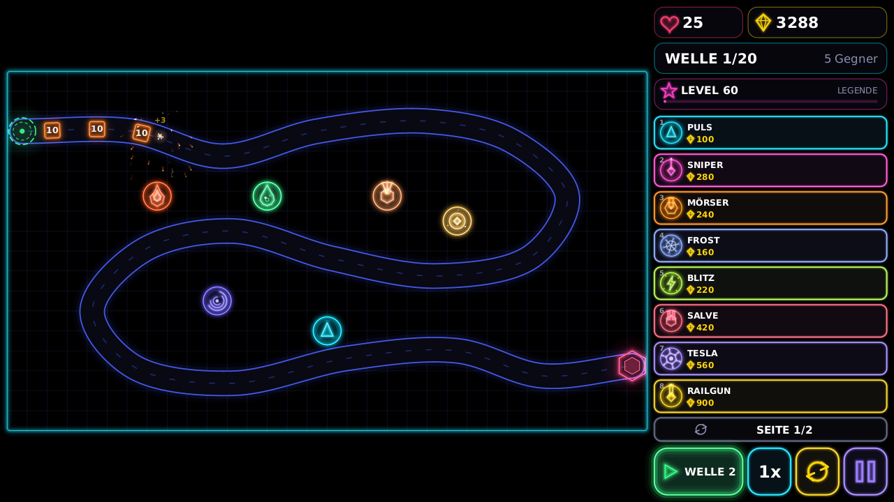
  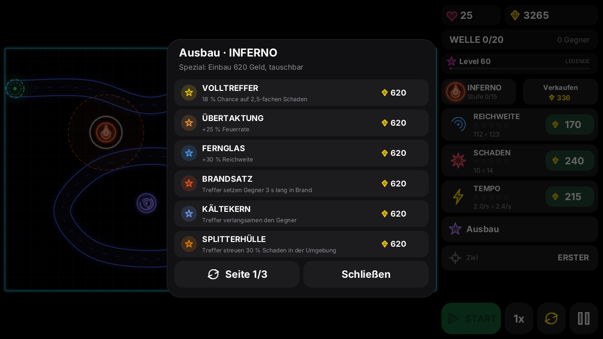
</p>

## Die Gegner

| Gegner | Form | Besonderheit |
|---|---|---|
| Block | Quadrat | Standard |
| Dart | Dreieck | schnell, wenig HP |
| Splitter | gestrichelte Raute | zerfällt in 3 Minis |
| Mini | Kreis | klein und flink |
| Koloss | Sechseck | langsam, sehr zäh, kostet 3 Leben |
| Titan | Achteck | Boss, kostet 10 Leben |
| **Panzer** | Fünfeck | Treffer unter 3 % seiner Lebenspunkte richten nur 65 % Schaden an – braucht Schwergewichte (Sniper, Mörser, Railgun) |
| **Schildträger** | Kreis mit Ring | trägt ein Schild (+40 % der HP), das sich auflädt, wenn er 2 s in Ruhe bleibt – Dauerfeuer lohnt sich |
| **Sanitäter** | Kreuz | heilt alle Gegner in 110 Einheiten alle 1,5 s um 2,5 % – zuerst ausschalten |
| **Phantom** | Stern | schnell; in den letzten 1,2 s jedes 4,2-s-Zyklus durchsichtig und unverwundbar |

Die Elite-Gegner erscheinen ab Welle 7 (Schild), 10 (Sanitäter, nie in Titan-Wellen), 12 (Panzer) und 15 (Phantom) und
*ersetzen* einen Teil der Blöcke, damit die Gesamtlast einer Welle gleich bleibt. Brennen, Gift, Betäubung,
Rüstungsbruch und Schild sind am Gegner sichtbar.

Du startest mit 500 ◆ und 20 Leben (plus Startbonus aus dem Spielerlevel). Abschüsse und besiegte Wellen bringen
Geld; ein Gegner, der das Ziel erreicht, kostet Leben.

## Welten und Sterne

| Welt | Idee | Leben | Welt öffnet ab |
|---:|---|---:|---:|
| 1 Neonstadt | erste Runden durch die leuchtende Stadt – Schleifen, Zickzack, S-Kurven | 20 | – |
| 2 Tiefsee | Strömungen, Riffe und Schildträger – Doppelhelix, Grotte, zwei Bahnen | 20 | 11 ★ |
| 3 Magmakern | enge Schluchten voller Panzer – Kessel-Spirale, Lavastrom, Looping | 18 | 25 ★ |
| 4 Gewächshaus | Schwärme, Ranken und Splitter – Beete, Rankgitter, Rosette | 18 | 41 ★ |
| 5 Raumhafen | Phantome zwischen den Docks – Andockbahnen, Kreuzungen, Orbit | 16 | 59 ★ |
| 6 Kathedrale | Symmetrie, Heiler und Bollwerke – Schiff, Klosterhof, Rosenfenster | 16 | 79 ★ |
| 7 Datenstrom | Spiralen, Schleifen und Chaos – Bus, Schleifen, Spiralspeicher | 14 | 100 ★ |
| 8 Ereignishorizont | drei Wege, Titanen, kein Erbarmen – Singularität, Akkretion, Horizont | 12 | 118 ★ |

Jede Welt hat **sechs von Hand gebaute Strecken** mit je 20 Wellen; Level 6 ist immer das **Titanen-Boss-Level**.
Die Vorschau in der Levelauswahl zeigt die Strecke, `docs/screenshots/welt-*.png` alle 48 auf einen Blick. Die
Lebenspunkte der Gegner wachsen von Level zu Level und Welt zu Welt; der Faktor ist mit dem Test-Bot kalibriert
(`Calibrate`), jede Strecke ist schaffbar.

**Pads und Sperrzonen:** Auf vielen Strecken liegen **Pads** – Kreise, die dem Turm darauf Schaden (+25 %), Reichweite
(+25 %) oder Tempo (+20 %) geben – und **Sperrzonen** (Felsen, Riffe, Lava), auf denen nichts gebaut werden darf.
Pads liegen bewusst nicht immer an der besten Stelle.

**Sterne:** **3 ★** ohne ein verlorenes Leben, **2 ★** mit mindestens der Hälfte der Leben, **1 ★** für den Sieg. Jeder
neue Stern bringt 12 Kristalle und 120 XP. Ein Level wird frei, sobald das Level davor einen Stern hat (oder bereits
gespielt wurde); eine neue Welt öffnet mit der Sternzahl aus der Tabelle (die Welten davor müssen also nicht perfekt
sein – 144 Sterne gibt es insgesamt). Die Sternsumme steht auf der Bestenliste *Sterne*.

**Wellenstile:** Jedes Level hat einen Stil (`WaveStyle`), der bestimmt, aus welchen Gegnern die Wellen bestehen –
*Klassik*, *Schwarm*, *Ansturm*, *Schwergewichte*, *Splitter*, *Bollwerk*, *Panzerkolonne*, *Lazarett*, *Phantome*,
*Chaos* und *Titanen*. Jede Welt hat drei Stile, und innerhalb der Welt wechselt der Rhythmus (A · A+B · B · C · B+C ·
Titanen). Neue Gegnerarten kommen Welt für Welt dazu. Stil und Leben stehen auf der Levelkarte und im Start-Banner.

**Medaillen** gibt es weiter für die weiteste Welle im Endlosmodus eines Levels (Bronze 20 · Silber 50 · Gold 100 ·
Platin 250), jede einmalig mit XP und Kristallen.

<p align="center">
   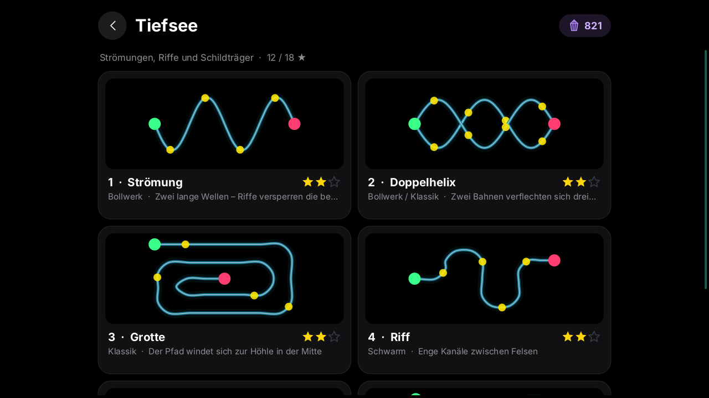
</p>

## Fortschritt

Dein **Spielerlevel** wächst mit jeder besiegten Welle (6 XP + Wellennummer, doppelt bei Titan-Wellen) und mit dem
ersten Sieg über ein Level (+300 XP, danach +100). Das Profil siehst du über die Karte oben links im Hauptmenü.

| Spielerlevel | Freischaltung |
|---:|---|
| 1 | **PULS** |
| 2 | **FROST** |
| 4 | **MÖRSER** |
| 6 | **BLITZ** |
| 8 | **SNIPER** |
| 10 | **SALVE** |
| 13 | **TESLA** |
| 16 | **RAILGUN** |

Dazu gibt es dauerhafte Belohnungen: **+10 Startgeld je Level** (bis +300) und **+1 Start-Leben je 5 Level** (bis +5).
Titel wie *Funke*, *Wächter*, *Architekt* oder *Titanbezwinger* zeigen den Rang. Als Maßstab: Der erste vollständige
Durchgang von Level 1 bringt Level 4 (772 XP), 1000 Endlos-Wellen etwa Level 63. Die Testspiele aus dem Level-Editor
zählen nicht für das Profil.

## Shop und Kristalle

**Kristalle** sind die Währung des Meta-Spiels (Symbol ◆ in Violett, oben rechts im Menü und auf allen Shop-Seiten).
Du bekommst sie

- für **besiegte Wellen** (1 + Welle/25, höchstens +5; Titan-Wellen +3) und **Siege** (+10 beim ersten, danach +3),
- für **Medaillen** (einmalig je Level: Bronze 6 · Silber 14 · Gold 30 · Platin 70) und **Level-Aufstiege** (+5),
- aus **Tagesaufgaben**, **Monatsaufgaben**, dem **Season-Pass** und **Errungenschaften**.

Der **Shop** (Hauptmenü → SHOP) hat drei Reiter: **TÜRME** (die acht Elite-Türme), **SPEZIAL** (16 Spezial-Upgrades) und
**FORSCHUNG** (zehn dauerhafte Boni in Stufen: Startgeld, Zusatzleben, Baurabatt, Restwert, Prämien, Wellenbonus,
Feuerkraft, Zieloptik, Kristallsuche, Erfahrung – zusammen +10 % Schaden, +8 % Reichweite, −15 % Baukosten, +20 %
Prämien, +30 % Wellenbonus, +9 % Verkaufswert, +400 Startgeld, +5 Leben, +30 % Kristalle, +30 % XP). Ein Tipp auf eine
Karte öffnet einen Bestätigungsdialog; Käufe gelten sofort und für immer. Alte Spielstände bekommen einmalig Kristalle
für das bisher Erreichte (Level, Medaillen, erste Siege).

<p align="center">
  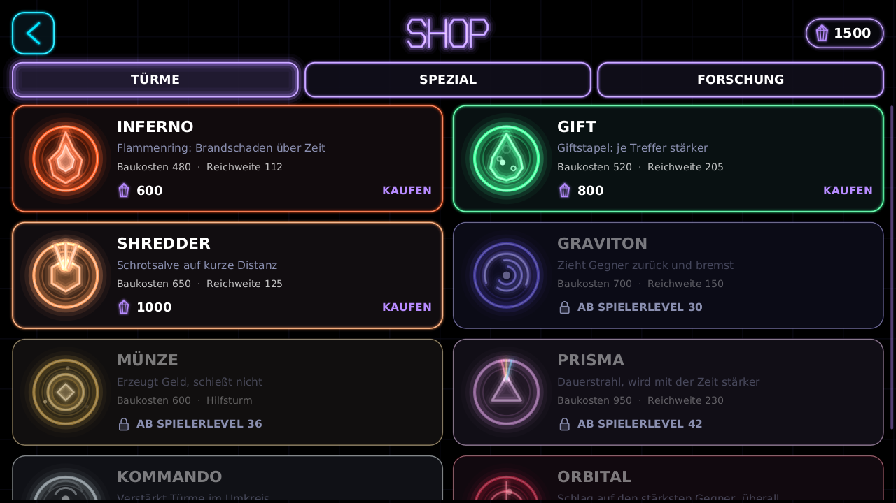 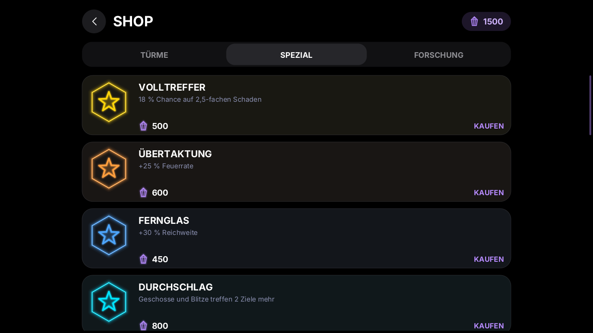 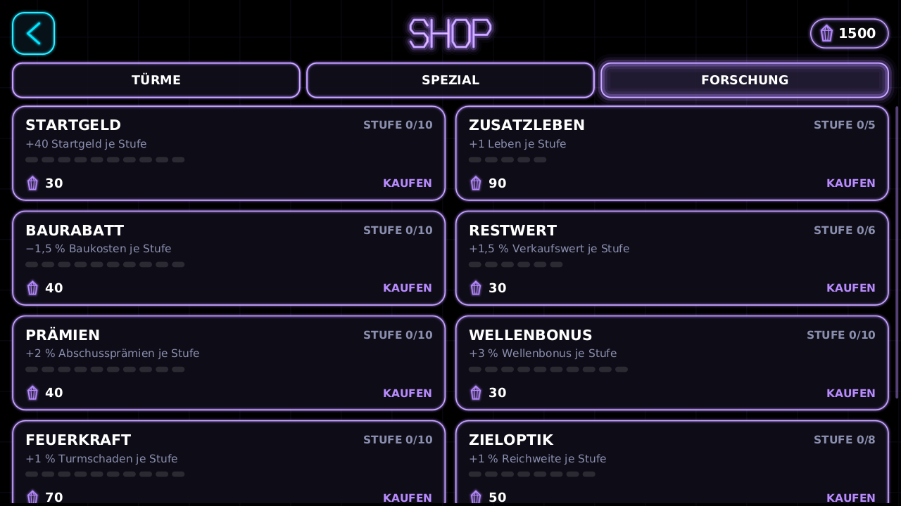
</p>

## Missionen, Season und Errungenschaften

**Tagesaufgaben:** Jeden Tag (um Mitternacht der Ortszeit) gibt es drei neue Aufgaben – leicht, mittel, schwer – aus
Abschüssen, Wellen, Titanen, Elite-Gegnern, Türmen, Upgrades, Spezials, Siegen und gestarteten Leveln. Jede bringt
Kristalle (25 / 40 / 65), XP und Season-XP; alle drei zusammen noch einen **Tagesbonus** (+30 Kristalle). Welche
Aufgaben es gibt, ergibt sich nur aus dem Datum – jedes Gerät sieht dieselben.

**Season-Pass:** Jeden Monat beginnt eine neue Season. Season-XP kommen aus Tages- und Monatsaufgaben und aus besiegten
Wellen (1 je 2 Wellen); **30 Stufen** à 150 XP, jede mit Kristallen (30 + 4·Stufe, Stufe 10/20/30 zusätzlich +150/+250/+500
und ein Titel). Dazu **sechs große Monatsaufgaben** (z. B. 6000 Gegner, 300 Endlos-Wellen, 50 Titanen). Alles ist
kostenlos; Belohnungen werden mit einem Tipp abgeholt (rote Markierung im Menü, solange etwas wartet).

**Errungenschaften:** 21 Familien mit zusammen **85 Stufen** (Abschüsse, Wellen, Titanen, Elite-Gegner, Türme, Upgrades,
Spezials, Siege, Medaillen, Platin, Welten, Sterne, Serie, Endlos-Wellen, Spielerlevel, Shop-Käufe, Forschung, Aufgaben, Season,
Kristalle). Jede erreichte Stufe schreibt sofort Kristalle gut und erscheint als Banner im Spiel.

<p align="center">
  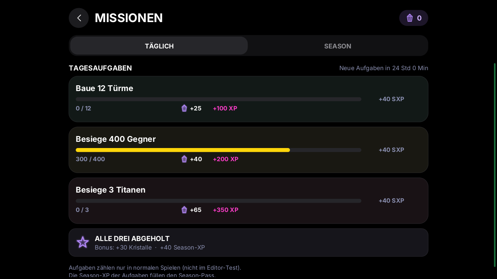 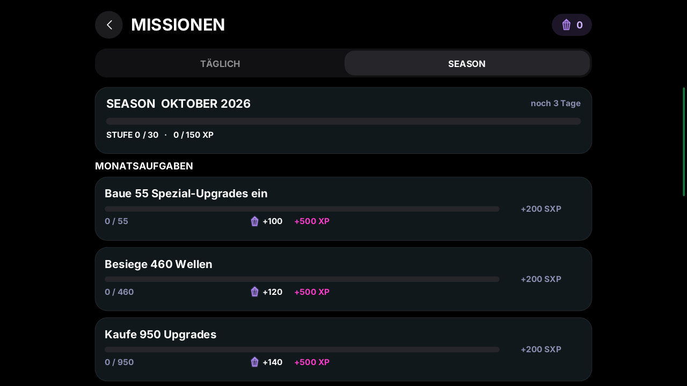 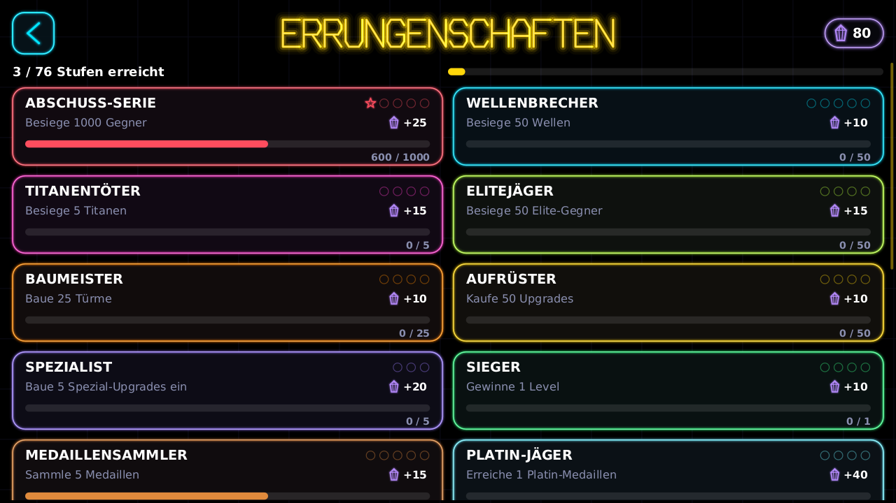
</p>

## Arena – der Wochen-Wettkampf

Die Arena ist der kompetitive Modus: **eine Woche lang denselben Highscore jagen**, dann kommt eine neue Arena.
Hauptmenü → Karte **Arena** (gleich unter „Weiter“) oder direkt **Antreten**.

**Gleiche Bedingungen für alle.** Jede Arena legt Karte (samt Pads und Sperrzonen), Gegnermischung, **fünf Türme**,
**zwei Joker-Spezials**, Startgeld und **10 Leben** fest. Spielerlevel, gekaufte Türme, Spezials und Forschung zählen
hier nicht – wer gestern angefangen hat, kämpft mit denselben Mitteln wie jemand mit Level 60. Ausbaupfade stehen allen
offen; Upgrades enden bei Stufe 5 (keine Meisterstufen), verlorene Leben kommen nicht zurück. Die Simulation ist
deterministisch: gleiche Züge, gleiches Ergebnis.

**Nicht zu einfach.** Die Lebenspunkte wachsen zusätzlich um 4 % je Welle. Die Härte ist mit dem Test-Bot kalibriert:
Er kommt je nach Arena bis etwa Welle 21–30 (`ArenaProbe`, abgesichert in `ArenaTest`). Wer Pads, Ausbaupfade, Joker und
den Vorlauf geschickt nutzt, kommt weiter – ein Titan, der durchkommt, beendet den Lauf aber sofort.

**Punkte.**

| | |
|---|---|
| Abschuss | Prämie der Gegnerart × Wellennummer × Multiplikator |
| Welle besiegt | 100 × Wellennummer × Multiplikator, mit **Vorlauf ×2** |
| Serie | jede Welle ohne durchgelassenen Gegner +0,1 auf den Multiplikator (bis **×3,0** nach 20 Wellen) |
| Durchbruch | ein einziger Gegner im Ziel setzt den Multiplikator auf ×1,0 zurück |
| Vorlauf | die nächste Welle starten, solange noch Gegner laufen (die Taste zeigt dann „VORLAUF ×2“) |

So entscheidet nicht nur, wie weit man kommt, sondern auch wie sauber und wie mutig: Ohne Durchbruch spielen, früh
nachlegen, aber nicht so früh, dass etwas durchrutscht.

**Im Lauf** zeigt das HUD Punkte, Multiplikator (grau → cyan → gold), Welle und den **Live-Platz**; der Balken unter dem
HUD füllt sich mit der Serie. Nach jeder Welle erscheint die **Zwischenzeit** gegen den Führenden der Woche und gegen den
eigenen Bestlauf („+1,2K vs Mia · −300 Bestwert“), beim Überholen meldet das Spiel „Platz 2 – an Tobi vorbei!“.
Am Ende: Punkte, Welle, beste Serie, **Platz von allen**, „Neuer Rekord“ und der Abstand zum Nächsten.

**Fair bleiben.** In der Arena wird nicht automatisch zwischengespeichert – ein Neustart der App spult also nicht
zurück. Nur wenn die App in den Hintergrund geht (Anruf, Wechsel), wird der Stand gesichert und kann fortgesetzt werden;
sobald es weitergeht, wird er verworfen. Der Server nimmt Läufe nur von angemeldeten Namen an, prüft Woche,
Plausibilität (Punkte zur Welle, Spielzeit) und lässt höchstens einen Lauf alle 10 Sekunden zu.

**Die Arena-Seite** hat drei Reiter: **Rangliste** (bester Lauf je Spieler mit Welle, Serie und Anzahl der Läufe),
**Verlauf** (die letzten Läufe der Woche, Rekorde markiert) und **Ruhmeshalle** (Wochensieger mit Titelzahl). Dazu
Restzeit, Regeln, der eigene Stand und **Herausfordern** (kopiert einen Text mit Punkten und Link zum Weiterschicken).
Wer in der Vorwoche dabei war, holt sich oben die Belohnung ab: **300 / 200 / 120 Kristalle** für Platz 1–3,
**40** fürs Mitmachen. Eine neue Arena beginnt **Montag 0 Uhr** (Kalenderwoche nach ISO, deutsche Zeit); acht Arenen
wechseln sich ab (Boulevard, Doppelhelix, Schmiede, Kreuzgang, Docking, Glockenturm, Netz, Gravitation).

<p align="center">
  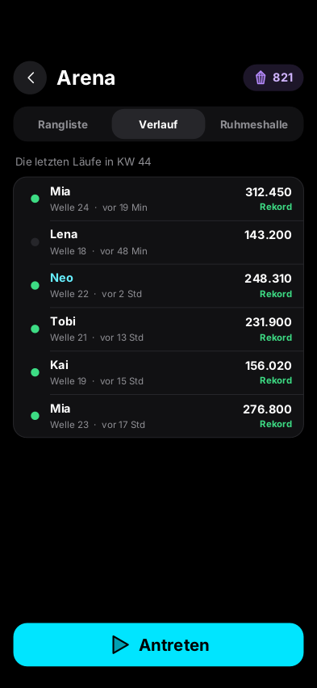 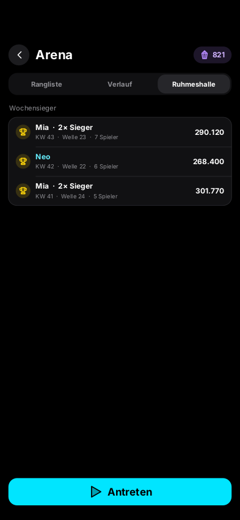
  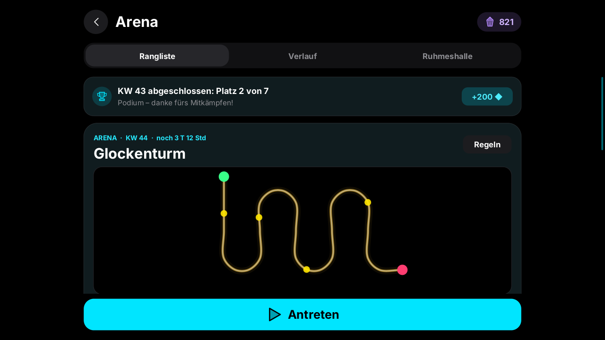<br>
  <sub>Screenshots mit Beispieldaten</sub>
</p>

## Spielername und Login-Log

Beim **ersten Start** fragt das Spiel nach dem Spielernamen (2–16 Zeichen: Buchstaben, Zahlen, Leerzeichen, `. _ -`).
Auf dem iPhone ist das ein echtes Eingabefeld mit der normalen Tastatur. Der Server prüft, dass der Name noch frei ist
(ohne Unterschied von Groß- und Kleinschreibung); ohne Netz gilt er vorläufig und wird später bestätigt – ist er dann
vergeben, fragt das Spiel beim nächsten Start erneut. Ändern: Profil → Name antippen.

Jeder App-Start landet im **Login-Log** (Tabelle `neontd_login_log`: Zeit, Name, Gerätekennung, Version, Gerät/Browser/
Modus, z. B. „iPhone · Safari · App“), Namensänderungen als eigenes Ereignis. Die Ansicht `neontd_login_uebersicht`
fasst je Gerät erste und letzte Anmeldung und die Zahl der Starts zusammen. Beides ist nur im Supabase-Dashboard lesbar,
nicht über die App.

**Datenbank.** Alles liegt in einer kleinen Supabase-Datenbank (Tabellen `neontd_spieler`, `neontd_login_log`,
`neontd_arena`, `neontd_bestenliste`). Der öffentliche Schlüssel im Spiel kann die Tabellen weder lesen noch schreiben,
nur die Funktionen `rpc/neontd_*` aufrufen; die zufällige Gerätekennung bleibt privat, öffentlich sichtbar ist nur eine
daraus abgeleitete Kennung, an der das Spiel den eigenen Eintrag erkennt.

## Tages-Challenge, Serie und Bestenliste

**Tages-Challenge:** Jeden Tag (Ortszeit) wählt das Spiel aus dem Datum ein Level und einen **Modifikator** – alle
Geräte sehen dieselbe Aufgabe: *Tempo* (Gegner 25 % schneller), *Sparsam* (weniger Startgeld), *Glas* (nur 5 Leben),
*Titanen* (Boss alle fünf Wellen), *Schwarm*, *Panzer*, *Phantome* oder *Zäh* (mehr Lebenspunkte). Gespielt wird im
Endlosmodus: Es zählt die weiteste Welle. Ab **Welle 15** gibt es einmalig **40 Kristalle**; der Lauf lässt sich wie
jeder andere speichern und fortsetzen.

**Serie:** Wer an aufeinanderfolgenden Tagen mindestens eine Welle besiegt, verlängert seine Serie (Flamme im Menü und im
Profil). Ab zwei Tagen meldet das Spiel die Serie, die Errungenschaft *Dranbleiber* belohnt 3 · 7 · 30 · 100 Tage.

**Bestenliste** (Hauptmenü → Bestenliste): drei Listen – **Heute** (Welle der Tages-Challenge), **Endlos** (beste
Endlos-Welle auf einer eingebauten Strecke) und **Sterne** (Sternsumme). Jedes Gerät hat eine zufällige Kennung, gezählt
wird je Liste der beste Eintrag; der eigene ist hervorgehoben. Als Name dient der Profilname (Profil → Stift). Die
Einträge liegen in einer kleinen Supabase-Tabelle, die mit dem öffentlichen Schlüssel nur Einfügen und Lesen erlaubt;
ohne Netz merkt sich das Spiel den Eintrag und schickt ihn später.

## Wie lange dauert alles?

Das Ziel: Wer **etwa 10 Minuten am Tag** spielt (≈ 40 Wellen bei 2–3-fachem Tempo) und die Tagesaufgaben abholt, braucht
**rund vier Monate**, bis alle Türme, Spezials und Forschungsstufen gekauft sind. Die Summe aller Preise ist **44 660
Kristalle** (Türme 12 700 · Spezials 16 950 · Forschung 15 010); die Einnahmen liegen bei etwa 350 Kristallen am Tag
(Wellen ≈ 100, Tagesaufgaben 160, Season ≈ 90, Rest Errungenschaften und Level-Aufstiege). Dazu bremsen die Spielerlevel
(Elite-Türme ab Level 12 bis 55). Das Modell dafür ist `neontd.progress.EconomyModel` (`java -cp … EconomyModel 40`),
und `ProgressionTest` prüft die Zahlen:

| Wellen pro Tag | alles freigeschaltet nach |
|---:|---|
| 25 (ca. 6 Min) | ≈ 5,5 Monate |
| 40 (ca. 10 Min) | ≈ 4 Monate |
| 60 (ca. 15 Min) | ≈ 3 Monate |

## Einstellungen und Zurücksetzen

**Hauptmenü → EINSTELLUNGEN** (Zahnrad): *Profil* (Name, Cloud, Statistik), **SPIELERLEVEL ZURÜCKSETZEN** (Level und XP
zurück auf 0, Medaillen, Shop, Kristalle und Aufgaben bleiben) und **ALLES ZURÜCKSETZEN** (das ganze Profil bis auf den
Namen; laufende Spiele werden beendet, eigene Level bleiben). Beides fragt vorher mit einem Dialog nach. Ein
Zurücksetzen merkt sich seinen Zeitpunkt: Beim Cloud-Abgleich gewinnt immer der Stand mit dem jüngeren Zurücksetzen, es
kommt also nichts Altes von einem anderen Gerät zurück.

<p align="center">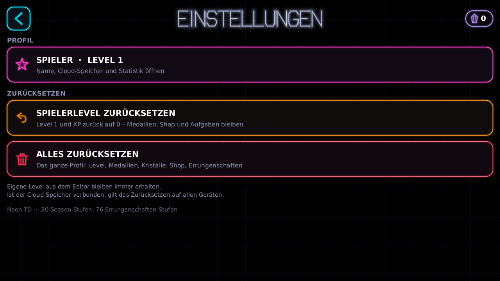 </p>

## Endlosmodus

Nach dem Sieg über die letzte Welle erscheint **ENDLOS WEITER** (und in der Levelauswahl, sobald das Level einmal
gewonnen wurde, **ENDLOSMODUS** für einen frischen Start). Dann gilt:

- Es gibt keinen Sieg mehr – nur noch „wie weit kommst du“. Alle 10 besiegten Wellen kommt ein verlorenes Leben zurück.
- **Meisterstufen:** Reichweite, Schaden und Tempo lassen sich über Stufe 5 hinaus ausbauen (Schaden bis Stufe 60,
  Tempo bis 18, Reichweite bis 12). Jede Meisterstufe macht den Turm um einen festen Faktor stärker und ist um den
  Faktor 1,36 teurer (Schaden ×1,23 und Tempo ×1,10 je Stufe, Reichweite +0,07) – gold angezeigt als „+n“.
- **Tempo 5×** und ein früherer automatischer Wellenstart, damit die Läufe nicht endlos dauern (eine Welle braucht im
  Schnitt ~40 s; 1000 Wellen sind bei 5× gut zwei Stunden).
- HP-Zahlen und Preise werden kurz geschrieben (`15K`, `2.3M`).

**Wie das bis Welle 1000 trägt:** Die Lebenspunkte wachsen quadratisch und ab Welle 100 zusätzlich leicht
exponentiell (Welle 1000: rund 16 Mio. für einen Block, 470 Mio. für einen Titan – noch im `int`-Bereich). Die *Zahl*
der Gegner ist begrenzt (höchstens ~240 je Welle), damit Bildschirm und Rechenzeit stabil bleiben. Prämien wachsen
langsamer als die HP (Exponent 0,625), dafür sorgen die Meisterstufen für den Ausgleich. Geld, Schaden und Preise sind
nach oben begrenzt, sodass nichts überlaufen kann. `EndlessProbe` lässt einen einfachen Bot 1000 Wellen spielen:
Er schafft es gerade eben (Leben 20, Welle 1000 dauert dann ~80 s) – ein menschlicher Spieler mit besserer Strategie
hat Luft. Ein Test (`EndlessTest`) sichert die Zahlen ab.

## Speichern, Fortsetzen und Cloud

**Lokal:** Profil, eigene Level und der laufende Lauf liegen im Speicher des Geräts (`localStorage` im Browser, Datei
`~/.neon-td/save.properties` auf dem Desktop). Der Lauf wird alle paar Sekunden und nach jeder besiegten Welle
gesichert, außerdem beim Pausieren, beim Verlassen und wenn die App in den Hintergrund geht. In der Levelauswahl
erscheint dann **FORTSETZEN · WELLE n**. Gesichert wird, sobald eine Welle fertig „ausgespielt“ ist (alle Gegner sind
erschienen); Geschosse und Effekte gehören nicht dazu.

**Über GitHub? Ja – mit einem privaten Gist.** GitHub hat keinen Speicher „pro Spieler“ für eine statische Seite, aber
jedes GitHub-Konto kann **Gists** (kleine private Dateien) anlegen. Das Spiel nutzt genau einen davon
(`neon-td-save.json`) und gleicht Profil, eigene Level und den laufenden Lauf dort ab. Einrichten (einmalig, ~1 Minute):

1. Im Spiel **Profil → CLOUD-SPEICHER → TOKEN ERSTELLEN** öffnet die GitHub-Seite mit bereits gesetzter Berechtigung
   *gist* (oder selbst: GitHub → Settings → Developer settings → Personal access tokens → *Generate new token
   (classic)*, Haken nur bei **gist**).
2. **Expiration: „No expiration“** wählen, damit die Verbindung lange hält, dann **Generate token** und den Text
   (`ghp_…`) kopieren.
3. Im Spiel **MIT GITHUB VERBINDEN** und das Token einfügen. Fertig: Das Spiel legt den privaten Gist an und gleicht ab –
   beim Start, nach Änderungen (höchstens alle 3 Minuten), beim Verlassen der App und am Ende eines Spiels.
4. Auf weiteren Geräten (oder in der Home-Bildschirm-App) dasselbe Token einfügen – der Stand kommt von selbst.

Der Abgleich **führt zusammen, statt zu überschreiben**: Zähler und Rekorde nehmen den größeren Wert, gewonnene Level
werden vereinigt, eigene Level und gelöschte Level werden per Zeitstempel abgeglichen, bei laufenden Spielen gewinnt der
jüngere. Wer auf zwei Geräten gespielt hat, verliert dadurch keinen Fortschritt. Als Anzeigename dient der GitHub-Name,
solange du keinen eigenen gewählt hast (im Profil über den Stift änderbar).

**Datenschutz und Sicherheit:** Das Token bleibt **ausschließlich im lokalen Speicher dieses Geräts** und wird nur an
`api.github.com` gesendet – nie in den Gist geschrieben, nie an einen anderen Server. Es kann *nur* Gists lesen und
schreiben (keine Repositories). Wer an dein entsperrtes Gerät kommt, könnte es auslesen; widerrufen lässt es sich
jederzeit unter github.com/settings/tokens. **TRENNEN** entfernt es vom Gerät (Spielstand und Cloud-Kopie bleiben). Das
Spiel lädt keine fremden Skripte, in die Seite eingeschleuste Fremdskripte sind also nicht zu befürchten.

**Ohne Konto:** *Profil → SICHERUNG PER CODE* kopiert Profil und eigene Level als Text (`NTD1:…`), den man auf einem
anderen Gerät einfügt (auch ein ungültiger Code richtet nichts an). Gleichzeitig bittet das Spiel den Browser, den
Speicher dauerhaft zu halten; die Home-Bildschirm-App ist nach Apples Regeln außerdem von der automatischen Löschung
nach längerer Nichtnutzung ausgenommen, normale Safari-Tabs nicht.

## Level-Editor

Hauptmenü → **Level-Editor** (oder in der Levelauswahl **Neues Level**).

- **Punkte** – tippen setzt einen Punkt (nahe am Pfad wird er eingefügt, sonst hinten angehängt); Punkte lassen sich
  ziehen. Der Pfad ist ein glatter Spline durch alle Punkte und zeigt die echte Spurbreite.
- **Zeichnen** – mit Finger oder Maus freihändig einen Pfad zeichnen; er wird automatisch zu wenigen Punkten vereinfacht.
- **Löschen** – Punkte antippen, um sie zu entfernen.
- **1 · 2 · 3 · +** – bis zu drei Pfade; Gegner wechseln sich zwischen ihnen ab.
- **Rückgängig / Wiederholen**, **✕** leert den aktuellen Pfad.
- **Testen** spielt das Level sofort probe, **Speichern** legt es in der Levelauswahl ab.

Ein spielbares Level braucht mindestens einen Pfad mit mindestens 700 Einheiten Länge, alle Punkte im Spielfeld.
Die Wellen für eigene Level werden automatisch erzeugt (25 Wellen mit steigender Schwierigkeit). Gespeichert wird im
Browser (`localStorage`) bzw. auf dem Desktop in einer Datei.

## Für Entwickler

```
core/      reines Java ohne Abhängigkeiten – Simulation, Physik, Darstellung, UI, Szenen (läuft überall)
desktop/   Java2D-Fenster, Screenshot-Werkzeug, Icon-Generator
web/       TeaVM-Brücke: Java → JavaScript, Canvas2D, Zeiger-Ereignisse, PWA (Manifest, Service Worker, Icons)
```

```bash
./gradlew test                  # 190+ Tests: Physik, Simulation, Elite-Gegner/-Türme/Spezials/Ausbaupfade, Welten/Sterne, Arena, Bestenliste, Endlos, Fortschritt, Shop, Aufgaben, Speichern/Cloud-Abgleich, Layouts, Szenen
./gradlew build                 # alles bauen: Tests, Web (build/dist), Desktop-Paket
./gradlew :web:assembleWeb -PdebugJs      # Web-Version unminifiziert, zum Debuggen
./scripts/screenshots.sh        # Screenshots der Doku neu erzeugen (läuft ohne Fenster)
node scripts/web-smoke.mjs      # Browser-Test der echten Web-Version in Chromium (Handy-Layouts, Speichern, Cloud mit Mock-GitHub, Name und Arena mit Mock-Datenbank)
```

Wie die Physik, die Simulation und die Darstellung zusammenhängen und wie man neue Türme, Gegner, Level oder eine
Fortschritts-Schicht ergänzt, steht in **[docs/ENTWICKLUNG.md](docs/ENTWICKLUNG.md)**.

## Ausblick

Naheliegende nächste Schritte: Ton, Wiederholungen aus aufgezeichneten Befehlen (die Simulation ist deterministisch –
damit ließen sich Arena-Läufe auch auf dem Server nachrechnen und der Lauf des Wochensiegers ansehen), weitere Arenen,
Welten und Elite-Pfade. Der Spielstand-Mechanismus (`neontd.save`),
das Profil (`neontd.progress`) und die Bestenliste (`neontd.save.Leaderboard`) sind dafür vorbereitet – siehe
[docs/ENTWICKLUNG.md](docs/ENTWICKLUNG.md).
